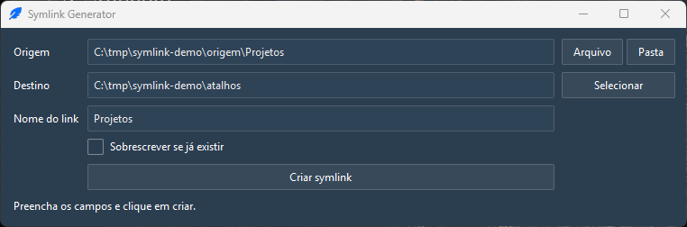
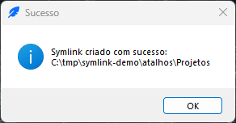
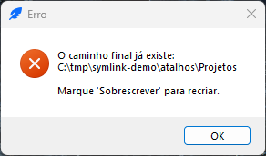

# Symlink Generator

Cria symlinks no Windows por uma janela simples, sem linha de comando.



Um symlink é um atalho de verdade. O item aparece no destino e continua sendo o mesmo arquivo ou a mesma pasta da origem, então editar pelo link edita o original. Isso resolve três situações comuns: o mesmo projeto precisa aparecer em duas pastas, uma pasta grande não pode ser copiada para outro disco, e uma ferramenta exige o arquivo num caminho fixo. O app faz isso com dois cliques, sem abrir o Prompt de Comando.

## Requisitos

Windows 10 ou Windows 11. Para criar symlink o Windows exige permissão especial, que vem do Modo de Desenvolvedor ligado ou de uma janela aberta como administrador. Os detalhes estão em Solução de problemas.

O executável não precisa de Python instalado. Ele já traz tudo o que usa.

## Instalação

### Pelo executável

1. Abra a página de Releases do repositório e baixe o `symlink-generator.exe`.
2. Crie a pasta `%LOCALAPPDATA%\Programs\symlink-generator\` e guarde o arquivo lá.
3. Se quiser, crie um atalho no Menu Iniciar ou na Área de Trabalho apontando para esse arquivo.

O executável tem cerca de 20 MB e não é assinado digitalmente. O Windows pode mostrar o aviso do SmartScreen na primeira execução. Clique em Mais informações e depois em Executar assim mesmo.

### Pelo código

Com o `uv` instalado:

```powershell
uv tool install git+https://github.com/pagueru/symlink-generator
symlink-generator
```

Também dá para clonar o repositório e rodar `uv run symlink-generator` de dentro dele.

## Como usar

1. Em Origem, informe o arquivo ou a pasta que vai virar link. Use os botões Arquivo e Pasta para escolher, ou cole o caminho no campo.
2. Em Destino, informe a pasta onde o link vai nascer. O botão Selecionar abre o seletor de pastas.
3. Em Nome do link, escolha o nome do atalho. Se deixar vazio, o app usa o nome da origem.
4. Deixe Sobrescrever se já existir desmarcado, a não ser que você queira trocar um link antigo.
5. Clique em Criar symlink.

Quando dá certo, o Windows mostra o caminho final do link.



Depois do aviso, os campos são limpos e o app fica pronto para o próximo link.

Se já houver algo no caminho final e a sobrescrita estiver desmarcada, o app avisa e não mexe em nada.



## Como funciona o Sobrescrever

A opção Sobrescrever só troca um link que já existe, seja symlink ou junction. Ela remove o link antigo e cria o novo no mesmo lugar.

Ela nunca apaga um arquivo ou uma pasta de verdade. Se o caminho final for um item real, o app recusa a operação e pede para você remover ou renomear o item na mão. O motivo é simples: apagar um arquivo real por engano não tem volta, e um clique não deveria causar isso.

## Solução de problemas

### O Windows recusou a criação por falta de permissão

Ligue o Modo de Desenvolvedor. No Windows 11 o caminho é Configurações > Sistema > Para desenvolvedores. No Windows 10 é Configurações > Atualização e Segurança > Para desenvolvedores. A outra saída é abrir o app como administrador.

Sem essa permissão o Windows devolve o erro 1314 e o app mostra a mensagem de permissão no lugar do detalhe técnico.

### O SmartScreen avisou que o app não é reconhecido

Acontece porque o executável não tem assinatura digital. Clique em Mais informações e depois em Executar assim mesmo. O app não usa UPX de propósito, porque compactador de executável costuma gerar falso positivo de antivírus.

### O destino precisa ser um diretório

O campo Destino aceita só pasta. Se você colou o caminho de um arquivo, o app recusa. Ajuste para a pasta que deve receber o link.

### Nome de link inválido

Use só o nome, sem caminho. O app recusa barra, os caracteres `< > : " | ? *`, ponto ou espaço no final, e também os nomes reservados do Windows, como `CON`, `NUL` e `COM1`.

### O caminho final já existe e não é um link

Existe um arquivo ou uma pasta real no lugar do link. Remova ou renomeie esse item na mão e crie o link de novo. O app não faz essa remoção por você.

## Documentação

- [Arquitetura](docs/architecture.md) mostra como o código está dividido e onde cada regra mora.
- [Desenvolvimento](docs/development.md) explica como rodar, testar e gerar o executável.
- [Changelog](CHANGELOG.md) lista o que mudou em cada versão.

## Licença

MIT. Veja o arquivo `LICENSE`.
