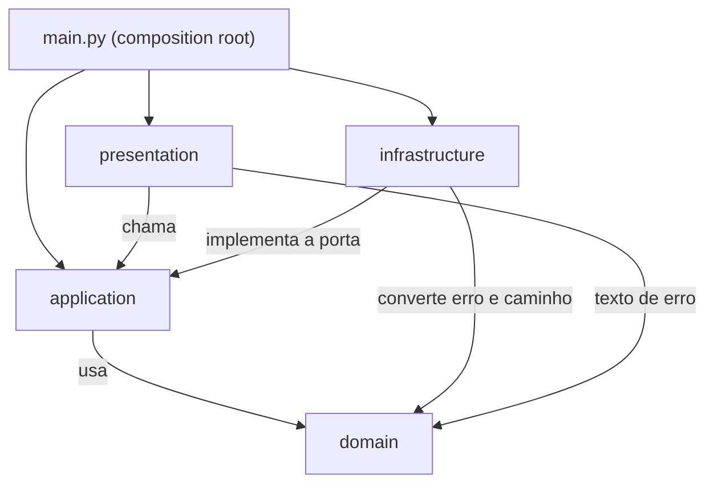

# Arquitetura

O app é uma janela Tk que cria symlinks no Windows. O código está dividido em quatro camadas, e cada camada só conhece as de dentro: a apresentação chama o caso de uso, o caso de uso chama o domínio, e o disco fica atrás de uma porta.

## Camadas

- `domain`: modelos, erros e regras de caminho. Não toca disco, não lê ambiente e não importa nada de fora da biblioteca padrão. É a parte que dá para testar sem criar arquivo nenhum.
- `application`: o caso de uso `CreateSymlinkUseCase`, que recebe o texto cru da tela e executa as validações na ordem certa. Ele fala com o disco só pela porta `FileSystemPort`.
- `infrastructure`: `LocalFileSystem`, a implementação da porta sobre `pathlib`. É o único lugar que resolve caminho, checa existência e cria o link de verdade.
- `presentation`: `messages` com os textos fixos, `presenter` com a lógica de tela testável sem janela, e `tk_view` com os widgets e os diálogos nativos.

`main.py` é a composition root. Ele monta a janela, injeta `LocalFileSystem` no caso de uso e liga o botão ao presenter. Nenhuma outra parte do código constrói dependência.

## Regra de dependência



As setas apontam para dentro. O domínio não importa nada das outras camadas. A aplicação conhece só o protocolo da porta, nunca `pathlib` direto, e é por isso que os testes de caso de uso rodam em memória, sem criar arquivo.

## Mapa de arquivos

```
src/symlink_generator/
  __init__.py          versão do pacote
  __main__.py          entrada usada pelo PyInstaller e por python -m
  main.py              App, build_app, main, report_callback_exception
  domain/
    models.py          LinkRequest, LinkResult
    errors.py          hierarquia de erros esperados
    paths.py           clean_path_text, validate_link_name
  application/
    ports.py           FileSystemPort
    create_symlink.py  CreateSymlinkCommand, CreateSymlinkUseCase
  infrastructure/
    local_filesystem.py LocalFileSystem
  presentation/
    messages.py        textos fixos e describe_error
    presenter.py       SymlinkView, SymlinkFormPresenter
    tk_view.py         TkSymlinkView
```

## Por onde passa cada decisão

- Sobrescrever só troca link: `application/create_symlink.py`, no método `_ensure_target_is_replaceable`. Se o caminho final existe, não é sobrescrita autorizada e não é link, o erro `TargetNotALinkError` sobe antes de qualquer escrita.
- Regra do nome do link: `domain/paths.py`, em `validate_link_name`. Recusa barra, `<>:"|?*`, ponto ou espaço no final, `.` e `..`, e os nomes de dispositivo do Windows com ou sem extensão. A origem sem nome próprio vira `LinkNameRequiredError` no caso de uso.
- Falta de permissão do Windows: o caso de uso converte `OSError` com `winerror == 1314` em `PrivilegeRequiredError`, e `presentation/messages.py` troca esse erro pela explicação do Modo de Desenvolvedor.
- Erro esperado e erro inesperado: `presenter.submit` trata todo `SymlinkGeneratorError` e mostra o texto de `describe_error`, sem deixar exceção escapar. O que não for esperado cai em `report_callback_exception`, que loga com traceback e mostra um diálogo genérico com o caminho do log. O log vai para `%LOCALAPPDATA%\symlink-generator\symlink-generator.log` (`main.log_file_path`), com giro a cada 1 MB. Isso importa porque o executável roda sem console, e uma exceção muda ali não aparece para ninguém.
- Tema e diálogos: `main.build_app` aplica o tema `superhero` do ttkbootstrap. Os diálogos continuam os nativos do `tkinter.messagebox`, como no script original, para manter a aparência e o comportamento padrão do Windows.
- Nome e local do executável: `packaging/symlink-generator.spec`, com `console=False`, `upx=False` e o nome `symlink-generator`. O README diz onde instalar.

## Como trocar a interface

O presenter depende do protocolo `SymlinkView`, que tem quatro métodos: `show_error`, `show_info`, `set_status` e `reset_form`, além da leitura do formulário pelo caso de uso. Para trocar Tk por outra biblioteca, basta escrever uma view nova que cumpra esse protocolo e trocar duas linhas em `build_app`.

O domínio, o caso de uso e o adaptador de disco continuam iguais. Nenhum deles importa `tkinter`, e essa é a garantia de que a troca não arrasta regra de negócio junto.

## Testes por camada

`tests/unit/test_domain.py` cobre as funções puras. `tests/unit/test_create_symlink.py` e `tests/unit/test_presenter.py` usam o `FakeFileSystem` do `tests/conftest.py`, que guarda arquivos, pastas e links em memória e permite injetar `OSError` por método. `tests/integration/test_local_filesystem.py` usa `tmp_path` real para provar que o adaptador funciona. `tests/gui/test_tk_view.py` monta a janela de verdade e está marcado com `gui`.
